# Revisiting Edge Ordering in Graph Reasoning with Large Language Models

**Taojie Wang, Chiyu Hao, and Zhengdong Huang**  
COMP5222 Advanced Machine Learning with Graphs, Hong Kong University of Science and Technology

## Abstract [DO NOT EDIT]

Improving the performance of large language models (LLMs) on graph tasks is an active area of research. GraphDO investigates how graph edges are ordered in textual descriptions and reports that structured ordering improves accuracy. In this project, we revisit these findings using GraphDO's public implementation, five edge orders, and the original prompt styles. We evaluate DeepSeek V4.1 Flash, GLM-5.3, and GPT-6 Luna on five traditional graph tasks, and DeepSeek and Luna on node classification. We identify three main findings. (1) Structured ordering provides smaller average gains and less consistent improvements than originally reported. (2) Tasks requiring a path or vertex ordering are generally more sensitive to edge order than yes/no graph questions. (3) The highest-scoring order depends on the model and prompt style as well as the task. These findings limit the generality of GraphDO's ordering gains and support validating each strategy in the setting where it will be used.

## 1. Introduction

Graphs represent relationships such as dependencies between tasks and citations between papers. Large language models (LLMs) often receive graphs as text, and how best to present these relationships for reasoning remains an open question. Ge et al. (2025) investigate one aspect of this problem with GraphDO. They find that presenting edges in a structured order improves GPT-3.5's accuracy over a randomly ordered edge list, and that the order yielding the highest accuracy depends on the task. [Ge et al. (2025), §§4–5](https://aclanthology.org/2025.acl-long.321/)

In this study, we replicate the main GraphDO experiment with the public implementation. We test whether the findings hold for three newer models, DeepSeek V4.1 Flash, GLM-5.3, and GPT-6 Luna, on connectivity, cycle detection, weighted shortest path, Hamiltonian path, topological sorting, and node classification. As in GraphDO, we compare random order with breadth-first search (BFS), depth-first search (DFS), PageRank (PR), and Personalized PageRank (PPR). We also vary the prompt style, which specifies the instructions and examples that accompany each question (§2.2). The first five tasks use zero-shot, zero-shot chain-of-thought (CoT), few-shot, CoT with worked examples, and CoT-BAG. Node classification uses zero-shot prompts. Following Ge et al., we ask three research questions.

1. **RQ1.** How does each structured edge order change accuracy relative to random order?
2. **RQ2.** Which graph tasks are most sensitive to edge order for each model and prompt style?
3. **RQ3.** Which orders score highest on each task, and how do the rankings vary by model?

Our replication recovers GraphDO's broad pattern of task-dependent sensitivity, but does not reproduce its consistent accuracy gains from structured ordering. Binary graph questions remain generally less sensitive than tasks requiring vertex sequences. Mean gains over random order are small, and none of the 300 traditional-task comparisons reaches statistical significance after Holm correction. An ordering benefit can even reverse across task families, with all four structured orders increasing Luna's mean accuracy on traditional tasks while reducing it on node classification. The highest-scoring order also varies with the model and prompt style, further limiting how far a preference observed in one setting can be transferred to another. These findings support evaluating an ordering strategy for the specific task, model, and prompt style in which it will be used.

## 2. Background

### 2.1 Graph prompts

A graph $G=(V,E)$ consists of vertices $V$ and edges $E$. A graph reasoning prompt contains a textual description of $G$ and a question $q$. The prompt style $p$ specifies which instructions or worked examples accompany the question. For an edge-list encoding, let $o$ be the rule that orders the edges and $g(G,o)$ the resulting text. A language model $M$ takes the prompt style, graph description, and question as inputs and returns $\hat{y}_o$.

$$
\hat{y}_o = M\bigl(p, g(G,o), q\bigr).
$$

GraphDO places the edges in a fixed text template. For example, the lists `[(0, 1), (1, 2), (0, 2)]` and `[(0, 2), (0, 1), (1, 2)]` describe the same undirected triangle, so Yes is the correct answer to a cycle-detection question for both inputs. By keeping $G$, $q$, and $p$ fixed, GraphDO can compare accuracy across the two descriptions. [Ge et al. (2025), §2.1 and §3.1](https://aclanthology.org/2025.acl-long.321.pdf#page=2)

### 2.2 Prompt styles

The same graph question can be presented with different amounts of guidance. For example, a cycle-detection prompt can present the question by itself, ask the model to reason through the graph, or show how a similar question was solved on another graph. Each version can use the same edge sequence for the graph being tested.

GraphDO uses five prompt styles for traditional graph tasks. The table below describes each style and gives an example prompt. CoT stands for chain-of-thought, and BAG stands for Build-a-Graph. [Ge et al. (2025), Appendix A.1 and Table 3](https://aclanthology.org/2025.acl-long.321.pdf#page=14)

The examples ask whether the same triangle contains a cycle. For styles that use demonstrations, one solved question on a two-edge path is shown before the triangle question.

| Prompt style | What the model receives | Example |
|---|---|---|
| Zero-shot | The test graph and its question | `Graph: [(0, 1), (1, 2), (0, 2)]. Is there a cycle?` |
| Zero-shot CoT | The test graph and question with an instruction to reason step by step | `Graph: [(0, 1), (1, 2), (0, 2)]. Is there a cycle? Think step by step.` |
| Few-shot | Example graphs, questions, and final answers before the test question | `Example graph: [(0, 1), (1, 2)]. Is there a cycle? Answer: No.` Then ask the triangle question. |
| CoT | Worked examples that show the reasoning leading to each answer | `Example graph: [(0, 1), (1, 2)]. Is there a cycle? These edges form a path with no loop. Answer: No.` Then ask the triangle question. |
| CoT-BAG | The CoT examples and an instruction to reconstruct the test graph from its nodes and edges before answering | Give the worked CoT example, then ask the triangle question with the instruction `Construct the graph from its nodes and edges first.` |

### 2.3 Graph reasoning and node classification

Graph tasks differ in the information they provide and the answers they require. A structural question uses the edges and any associated weights to ask whether a property holds or to request a solution that satisfies a constraint. For task like node classification, labels $\ell(v)$ are observed for vertices $v$ in a subset $L\subseteq V$. The goal is to predict $\ell(u)$ for a target vertex $u\in V\setminus L$ using the graph and the observed labels.

**Table 1. GraphDO tasks and expected answers.** [Ge et al. (2025), §2.2](https://aclanthology.org/2025.acl-long.321.pdf#page=3)

| Task | Meaning | Input graph | Expected answer |
|---|---|---|---|
| Connectivity | Check whether one queried vertex can reach the other along graph edges. | Undirected graph with two query vertices | Yes or No |
| Cycle detection | Check whether the graph contains a closed loop of edges. | Undirected graph | Yes or No |
| Hamiltonian path | Check whether a single path can visit every vertex exactly once. | Undirected graph | Yes or No. If Yes, give the path as a vertex sequence. |
| Weighted shortest path | Find the route with the lowest total edge weight from the source to the target. | Weighted undirected graph with a source and a target | A vertex sequence from source to target |
| Topological sorting | Put all vertices in an order that respects the dependencies encoded by the directed edges. | Directed acyclic graph | A list of all vertices with $u$ before $v$ for each edge $(u,v)$ |
| Node classification | Infer a vertex's class from the graph connections and the known vertex labels. | Citation subgraph with one masked label at vertex $u$, so $L=V\setminus\{u\}$ | The missing label $\ell(u)$ |

### 2.4 Edge ordering strategies

An ordering rule $o$ turns an edge set $E=\{e_1,\ldots,e_m\}$ into a sequence $L_o=(e_{\pi(1)},\ldots,e_{\pi(m)})$, where $\pi$ is a permutation of the edge indices. The sequence determines which edges appear first and which ones appear together in the prompt. For example, a traversal-based rule orders edges as a search encounters them while a ranking-based rule places edges incident to higher-ranked vertices earlier. 

GraphDO compares five edge orders, including a random baseline. Table 2 describes each ordering rule and gives the edge sequence it produces for the graph in Figure 1.

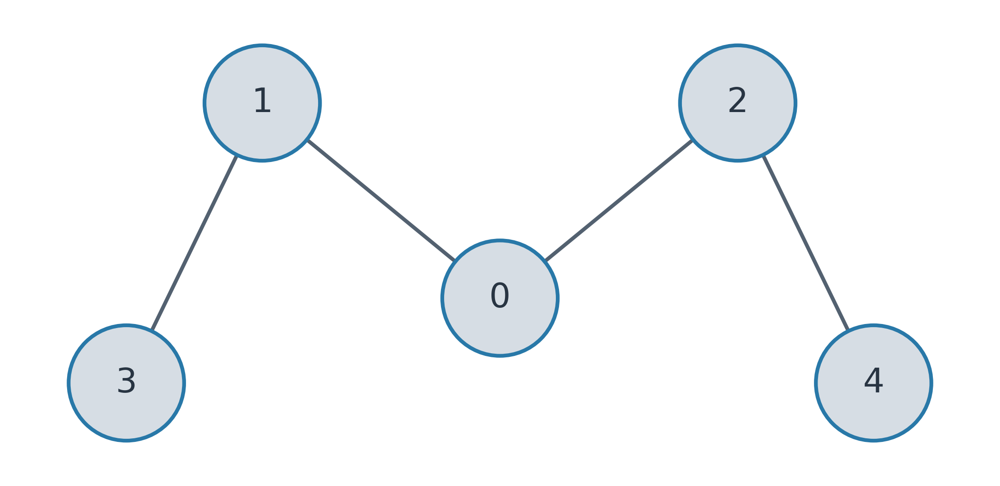

**Figure 1. Undirected graph used in the edge-order examples.**

**Table 2. Edge orders in GraphDO.** BFS and DFS start at vertex 0. PPR uses the node-classification rule with vertex 4 as the target. [Ge et al. (2025), §3.2](https://aclanthology.org/2025.acl-long.321.pdf#page=3)

| Edge order | How it arranges edges | Example |
|---|---|---|
| Random (baseline) | Shuffles the full edge list. | `[(1, 3), (0, 2), (2, 4), (0, 1)]` |
| Breadth-first search (BFS) | Visits adjacent edges level by level. | `[(0, 1), (0, 2), (1, 3), (2, 4)]` |
| Depth-first search (DFS) | Follows a branch of adjacent edges as far as possible before backtracking. | `[(0, 1), (0, 2), (2, 4), (1, 3)]` |
| PageRank (PR) | Ranks vertices by PageRank and lists edges incident to higher-ranked vertices earlier. | `[(0, 1), (1, 3), (0, 2), (2, 4)]` |
| Personalized PageRank (PPR) | Uses task-specific information to personalize the vertex ranking and lists edges incident to higher-ranked vertices earlier. | `[(0, 2), (2, 4), (0, 1), (1, 3)]` |

## 3. Experimental Design

### 3.1 Tasks and samples

Table 1 lists the six tasks we evaluate, all drawn from Ge et al. (2025). We use the graph generator, question templates, demonstrations, and evaluator from the public GraphDO implementation at commit `4ba8f925`. [GraphDO implementation](https://github.com/YuyaoGe/GraphDO/tree/4ba8f925c76574e2fca8d4f32f753b57a341b44f)

For the five traditional tasks, we use seed 42 to generate 140 Erdős–Rényi graphs per task. The generator uses an edge probability of 0.3 and samples graphs with 5 to 15 vertices. It caps the graph size at 12 vertices for the Hamiltonian-path task. For weighted shortest path, it assigns positive integer weights and chooses a source and target connected by a path. For topological sorting, it adds only edges that point forward in a sampled vertex ordering to ensure the graph is acyclic. [GraphDO Appendix B](https://aclanthology.org/2025.acl-long.321.pdf#page=14) · [Pinned graph generator](https://github.com/YuyaoGe/GraphDO/blob/4ba8f925c76574e2fca8d4f32f753b57a341b44f/graph_generator.py)

The Hamiltonian prompts name vertices only through their edges. In 62 generated graphs, this omits isolated vertices that the hidden ground truth still requires a path to visit. We exclude these graphs from all models, orders, and prompt styles in the main analysis, leaving 78 Hamiltonian graphs. The other four traditional tasks retain 140 graphs each. All generated responses remain archived.

For node classification, we use the Cora, CiteSeer, and PubMed citation networks provided by Planetoid. We draw 50-vertex subgraphs using 3-hop ego sampling and Forest Fire sampling. The Forest Fire sampler uses a burn probability of 0.3. We draw 25 subgraphs for each combination of dataset and sampler. In each subgraph, we sample one target vertex and mask its label. [Planetoid citation datasets](https://pytorch-geometric.readthedocs.io/en/latest/generated/torch_geometric.datasets.Planetoid.html) · [GraphDO Appendix B](https://aclanthology.org/2025.acl-long.321.pdf#page=14)

To stay within our token budget, we use half the original number of graphs per setting. For each task, we reuse the same graph-question pairs across edge orders, prompt styles, and models.

**Table 3. Sample sizes and prompting conditions.**

| Task | Query | Original sample | Replication sample | Prompt styles |
|---|---|---:|---:|---|
| Connectivity | Determine whether two queried vertices are connected | 280 | 140 | Zero-shot, zero-shot CoT, few-shot, CoT, CoT-BAG |
| Cycle detection | Determine whether an undirected graph contains a cycle | 280 | 140 | Zero-shot, zero-shot CoT, few-shot, CoT, CoT-BAG |
| Weighted shortest path | Return a minimum-weight path between two vertices | 280 | 140 | Zero-shot, zero-shot CoT, few-shot, CoT, CoT-BAG |
| Hamiltonian path | Determine whether a path visits every vertex once and give the path if it exists | 280 | 78 retained from 140 | Zero-shot, zero-shot CoT, few-shot, CoT, CoT-BAG |
| Topological sorting | Return a vertex ordering consistent with the directed edges | 280 | 140 | Zero-shot, zero-shot CoT, few-shot, CoT, CoT-BAG |
| Node classification | Predict one hidden vertex label in a labeled subgraph | 50 per dataset and sampler | 25 per dataset and sampler | Zero-shot |

### 3.2 Edge orders and prompts

For each of the five orders in Table 2, we generate one edge list per sampled graph using the settings in Table 4. We reuse each list across prompt styles, models, and repeats.

**Table 4. Edge-order settings used in the replication.** [GraphDO Appendix A.2](https://aclanthology.org/2025.acl-long.321.pdf#page=13) · [Pinned ordering implementation](https://github.com/YuyaoGe/GraphDO/blob/4ba8f925c76574e2fca8d4f32f753b57a341b44f/graph_ordering.py) · [Pinned description generator](https://github.com/YuyaoGe/GraphDO/blob/4ba8f925c76574e2fca8d4f32f753b57a341b44f/description_generator.py)

| Order | Applies to | Settings used |
|---|---|---|
| Random | All tasks | Initialize Python's random number generator with seed 42 at the start of benchmark construction, then shuffle each graph's edge list once. |
| BFS and DFS | All tasks | Traverse the line graph, where edges sharing an endpoint are adjacent. Start at the first edge incident to the first stored vertex, or the first listed edge if that vertex is isolated. Resume at the first unvisited edge when a component is exhausted. |
| PR and PPR | All tasks | Use NetworkX PageRank with a damping factor of $\alpha=0.85$. For the weighted shortest-path task, the ranking uses the stored edge weights. |
| PPR | Connectivity | Split the personalization weight equally between the two queried vertices. |
| PPR | Cycle detection | Split the weight equally among the vertices of one computed cycle. Use a uniform prior for an acyclic graph. |
| PPR | Hamiltonian path | Use the released implementation's uniform prior over all vertices. |
| PPR | Weighted shortest path | Split the weight equally among the vertices of a computed minimum-weight path between the queried endpoints. |
| PPR | Topological sorting | Split the weight equally among vertices with in-degree zero. |
| PPR | Node classification | Assign each vertex $v$ reachable from the target $u$ a weight of $d_{\max}-d(u,v)+1$, where $d_{\max}$ is the maximum distance from $u$ to a reachable vertex. Assign $10^{-5}$ to the remaining vertices and normalize the weights. |

We convert the five edge lists into text using the same template for a given task. We check that each description preserves the original edge set, including edge direction for directed graphs. An undirected edge can be written with either endpoint first. The encoder retains the edge weights for shortest path and, for node classification, appends the observed labels with the same target label masked in every description. [Pinned text encoder](https://github.com/YuyaoGe/GraphDO/blob/4ba8f925c76574e2fca8d4f32f753b57a341b44f/text_encoder.py)

We use the five prompt styles defined in §2.2 for each traditional task and zero-shot for node classification, as listed in Table 3. Within a prompt style, the question, instructions, and any demonstrations stay fixed across all five edge orders. [GraphDO Appendix A.1 and Table 3](https://aclanthology.org/2025.acl-long.321.pdf#page=14)

### 3.3 Model configurations

GraphDO used GPT-3.5-Turbo-0613 for its main experiments. Its supplementary experiments evaluated Llama 2 7B Chat, Llama 2 13B Chat, Qwen2-7B, Mistral-7B, and Vicuna-7B-v1.5. OpenAI retired the `gpt-3.5-turbo-0613` API snapshot on September 13, 2024, so we run the replication with DeepSeek V4.1 Flash, GLM-5.3, and GPT-6 Luna. These three models also let us test whether the reported edge-order effects carry over to newer LLMs. [Ge et al. (2025), §4.1](https://aclanthology.org/2025.acl-long.321.pdf#page=4) · [OpenAI API deprecations](https://developers.openai.com/api/docs/deprecations#past-deprecations)

### 3.4 Scoring and analysis

#### Final scoring

We score answers against the ground truth for each graph. Connectivity and cycle detection require a binary conclusion. Weighted shortest paths must use valid edges, connect the queried endpoints, and achieve the minimum total weight. Reversing a path is equivalent in these undirected graphs. Hamiltonian answers must supply a valid path or correctly reject its existence. Topological orders must respect every directed edge, with isolated vertices omitted from the prompt allowed to be absent. Answer extraction follows the final graph conclusion, including explicit corrections, rather than accepting any valid candidate mentioned during reasoning. We audit exceptional formats against the saved response text and independently cross-check graph truth and selected paths. For node classification, we extract the prediction for the target node, not labels mentioned for its neighbors. Abstentions and tool calls without an answer receive zero. Seven ambiguous traditional-task responses are conservatively scored zero and retained in a sensitivity check. Appendix A documents the scoring audit.

For an experimental cell with $n$ responses, the accuracy in percent is $A=\frac{100}{n}\sum_{i=1}^{n}s_i$, where $s_i$ is 1 if the answer is correct and 0 otherwise. Each traditional-task cell fixes the model, task, prompt style, and edge order. It contains 78 responses for Hamiltonian path and 140 for each other task. The main analysis therefore contains 15,950 responses per model. Family-level means give equal weight to the 25 task and prompt-style cells, so the exclusion does not reduce Hamiltonian path's weight. The archived data contain all 17,500 responses per model, including the 5,991 GLM responses generated with a higher output cap.

Each node-classification cell fixes the model, dataset, sampler, and edge order. There are 25 graph questions with three runs per question, giving 75 responses. The reported comparisons use DeepSeek and Luna, whose saved outputs are nonempty for every prompt. Nonempty output does not necessarily contain a prediction, as some responses abstain or contain only a tool call (§6).

#### Analysis by research question

**Table 5. Comparisons and metrics for the three research questions.** [GraphDO Figure 4](https://aclanthology.org/2025.acl-long.321.pdf#page=6) · [GraphDO Figure 5](https://aclanthology.org/2025.acl-long.321.pdf#page=7)

| Research question | Comparison | Metric |
|---|---|---|
| RQ1. Change from random order | Pair each structured-order response with its random-order counterpart by graph ID. For node classification, pair by repeat index as well. | Difference in accuracy in percentage points. Relative change expresses that difference as a percentage of the random-order accuracy when the baseline is nonzero. |
| RQ2. Sensitivity to order | For each model and traditional task, compare the five orders within each prompt style. | Population variance of the five accuracy values. Average the five style-specific variances to summarize each model and task. |
| RQ3. Highest-scoring order | For each model and traditional task, average each order's accuracy across the five prompt styles. For node classification, compare orders within each dataset-sampler group and summarize across groups. | Rank orders by accuracy, retaining ties. Compare orders using the relative difference in their scores. |

For each model, traditional task, and prompt style, we use a two-sided exact McNemar test to compare each structured order with random order on the same 78 Hamiltonian graphs or 140 graphs for the other tasks. The three models, five tasks, five prompt styles, and four structured orders give 300 comparisons. We apply Holm correction across these 300 tests. [Fagerland et al. (2013)](https://doi.org/10.1186/1471-2288-13-91) · [Holm (1979)](https://doi.org/10.2307/4615733)

We report the 48 node-classification comparisons descriptively because repeats share prompts and subgraphs can overlap.

## 4. Results

### 4.1 Research questions and previous results

Table 6 summarizes the three research questions and main findings from the experiments by Ge et al. (2025) with GPT-3.5-Turbo-0613. Across these experiments, structured edge orders consistently improved accuracy over random order. The highest-scoring order varied by task. Accuracy also varied more across orders on tasks that require global reasoning, such as topological sorting and weighted shortest path, than on local reasoning tasks such as connectivity and cycle detection. In the following subsections, we revisit each question with DeepSeek V4.1 Flash, GLM-5.3, and GPT-6 Luna. [Ge et al. (2025), §§2.2 and 4.2](https://aclanthology.org/2025.acl-long.321.pdf)

**Table 6. Research questions and findings in the original GraphDO study.**

| Research question | Original GraphDO finding |
|---|---|
| **RQ1.** How does edge order affect accuracy compared with random order? | Structured orders outperformed random order in all 100 traditional-task comparisons. For example, BFS increased mean cycle-detection accuracy from 64.50% to 72.71%. Structured orders also improved node classification across all six dataset-sampler settings. [GraphDO Table 1](https://aclanthology.org/2025.acl-long.321.pdf#page=5) · [GraphDO Table 2](https://aclanthology.org/2025.acl-long.321.pdf#page=6) |
| **RQ2.** Which graph tasks are most sensitive to edge order? | Accuracy varied less across orders for connectivity and cycle detection than for Hamiltonian path, topological sorting, and weighted shortest path. Weighted shortest path had the largest mean variance across the five prompt styles. [GraphDO Figure 4](https://aclanthology.org/2025.acl-long.321.pdf#page=6) |
| **RQ3.** Which edge order performs best on each task? | Averaged across prompt styles, BFS ranked first on connectivity, cycle detection, and weighted shortest path. DFS ranked first on Hamiltonian path and topological sorting. PageRank led or tied for first in all six node-classification settings. [GraphDO Table 1](https://aclanthology.org/2025.acl-long.321.pdf#page=5) · [GraphDO Table 2](https://aclanthology.org/2025.acl-long.321.pdf#page=6) |

### 4.2 RQ1. How much does edge order affect accuracy?

> **Finding 1.** Average accuracy gains from structured edge ordering are substantially smaller than in GraphDO.

The original study reported substantial mean accuracy gains from structured edge ordering, whereas the gains were much smaller in our replication. Even the largest improvement in Figure 2, achieved by Luna under PPR, was only 1.23 percentage points over random order. This was less than one-tenth of the original study's largest gain of 12.56 points under DFS. For DeepSeek and GLM, mean accuracy under all four structured orders remained within one percentage point of the random baseline. [GraphDO Table 1](https://aclanthology.org/2025.acl-long.321.pdf#page=5)

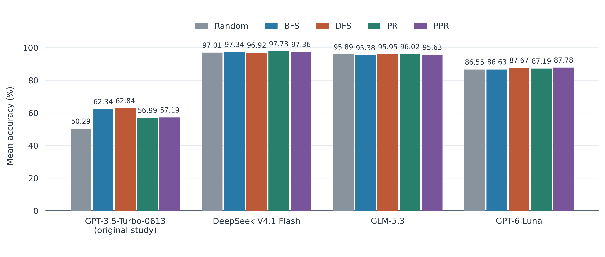

**Figure 2. Mean accuracy across edge orders on traditional graph tasks.** Each bar averages accuracy across five tasks and five prompt styles. GPT-3.5-Turbo-0613 values come from [GraphDO Table 1](https://aclanthology.org/2025.acl-long.321.pdf#page=5). The other models use our final scores. Gray bars indicate the random-order baseline.

> **Finding 2.** Structured ordering improves accuracy in fewer than half of the traditional-task comparisons.

Structured ordering did not provide a consistent advantage across tasks and prompt styles. Accuracy improved in only 40.7% of the 300 comparisons summarized in Figure 3, so most comparisons were ties or declines. By contrast, GraphDO reported improvements in all 100 comparisons with random order. Even Luna, the model with the most improvements in our replication, scored below random order in one-quarter of its comparisons.

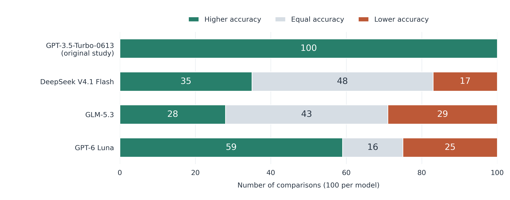

**Figure 3. Consistency of accuracy changes relative to random order.** Each bar summarizes 100 comparisons across five traditional tasks, five prompt styles, and four structured orders. Segment labels count comparisons with higher, equal, or lower accuracy than the corresponding random-order baseline. The categories describe numerical accuracy differences. Original-study counts are derived from [GraphDO Table 1](https://aclanthology.org/2025.acl-long.321.pdf#page=5).

**Table 7. Average accuracy changes relative to random order.** The Random column gives accuracy as a percentage, and the four structured-order columns show changes in percentage points. Traditional-task results average 25 combinations of task and prompt style. Node-classification results average six combinations of dataset and sampling method. The last column counts comparisons with higher, equal, or lower accuracy than random order, out of 100 traditional-task comparisons or 24 node-classification comparisons per model.

| Task family | Model | Random | BFS | DFS | PR | PPR | Higher / equal / lower |
| :--- | :--- | ---: | ---: | ---: | ---: | ---: | :---: |
| Traditional | DeepSeek V4.1 Flash | 97.01 | +0.34 | −0.08 | +0.73 | +0.35 | 35 / 48 / 17 |
| Traditional | GLM-5.3 | 95.89 | −0.51 | +0.06 | +0.13 | −0.26 | 28 / 43 / 29 |
| Traditional | GPT-6 Luna | 86.55 | +0.07 | +1.11 | +0.64 | +1.23 | 59 / 16 / 25 |
| Node classification | DeepSeek V4.1 Flash | 67.78 | −0.67 | +0.67 | +2.44 | +2.44 | 14 / 4 / 6 |
| Node classification | GPT-6 Luna | 56.89 | −2.89 | −3.11 | −11.11 | −11.56 | 6 / 1 / 17 |

> **Finding 3.** Larger observed gains occur in specific settings, but none of the 300 traditional-task comparisons is statistically significant after Holm correction.

Small average gains nevertheless concealed larger improvements in particular settings. For Luna, PPR increased weighted shortest-path accuracy under all five prompt styles shown in Figure 4, with gains ranging from 2.86 to 12.86 percentage points. The same task and order produced a different pattern for GLM, whose accuracy declined under four prompt styles and was unchanged under CoT. After Holm correction across all 300 traditional-task comparisons, neither these shortest-path differences nor any of the other tested differences reached statistical significance.

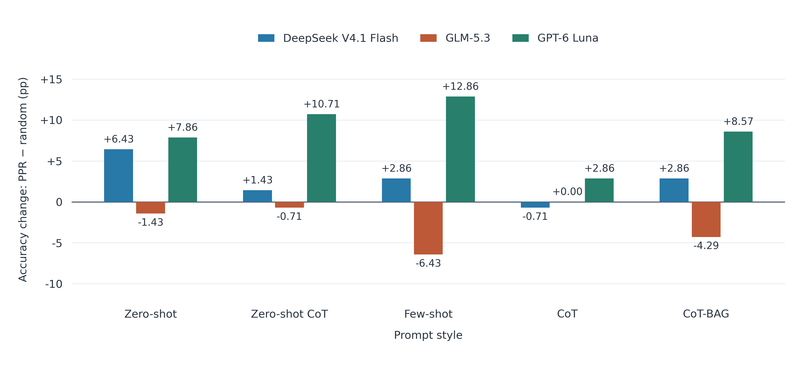

**Figure 4. PPR effects on weighted shortest path.** Bars show accuracy changes relative to random order (percentage points). Luna improved under all five prompt styles, DeepSeek under four, and GLM under none.

> **Finding 4.** An edge order can improve accuracy in one task family and reduce it in another, even for the same model.

An ordering benefit in one task family can reverse in another for the same model. For Luna, PPR increased mean accuracy on traditional tasks by 1.23 percentage points but reduced it on node classification by 11.56 points, as Figure 5 illustrates. The node-classification decline was widespread, occurring in five of the six combinations of dataset and sampling method in Appendix B. The exception was CiteSeer under Forest Fire sampling, where the gain outweighed the decline under ego sampling and yielded a small positive mean change for CiteSeer. The reversal between task families extended to all four structured orders in Table 7, each of which increased Luna's mean accuracy on traditional tasks but reduced it on node classification. Luna's predominantly negative results contrast with GraphDO's uniformly positive node-classification findings. [GraphDO Table 2](https://aclanthology.org/2025.acl-long.321.pdf#page=6) DeepSeek, by comparison, improved under PPR in both task families.

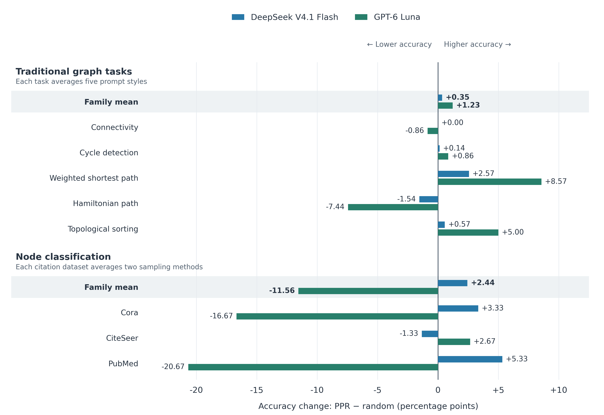

**Figure 5. PPR has opposite effects across task families for Luna.** Bars show accuracy changes relative to random order (percentage points). Shaded rows show family means. Each task averages five prompt styles, and each dataset averages two sampling methods.

We hypothesize that the benefit of structured ordering depends on whether the resulting sequence helps a model use the relationships relevant to the task. This account follows GraphDO's attention-bias hypothesis, which proposes that a model's attention to graph content can depend on its position in the input. [GraphDO §4.2](https://aclanthology.org/2025.acl-long.321.pdf#page=5) All four structured orders preserve the graph but change which edges appear early and which appear together. Such arrangements may make some relationships easier to follow while making others harder to connect. Because tasks depend on different graph relationships, an arrangement that helps one task may hinder another. Even for the same task, models may differ in how they use the same sequence. This could account for both Luna's reversal across task families under all four orders and the different model responses in Table 7.

### 4.3 RQ2. Which tasks are most sensitive to order?

> **Finding 5.** Connectivity and cycle detection are generally less sensitive to edge order than the three tasks requiring a vertex sequence.

Tasks requiring a vertex sequence as an answer were generally more sensitive to edge order than binary graph questions. The accuracy variances for the binary tasks in Figure 6 cluster near zero, with means below 0.53 squared percentage points for every model. This contrast also held in 14 of the 15 combinations of model and prompt style, where both binary tasks had lower variance than all three sequence tasks. The only exception was GLM under zero-shot prompting, where weighted shortest path had lower variance than cycle detection, at 0.29 versus 0.49 squared percentage points. This broad separation largely reproduces GraphDO's distinction between binary questions and tasks requiring more extensive graph reasoning. [GraphDO §4.2 Q2](https://aclanthology.org/2025.acl-long.321.pdf#page=5)

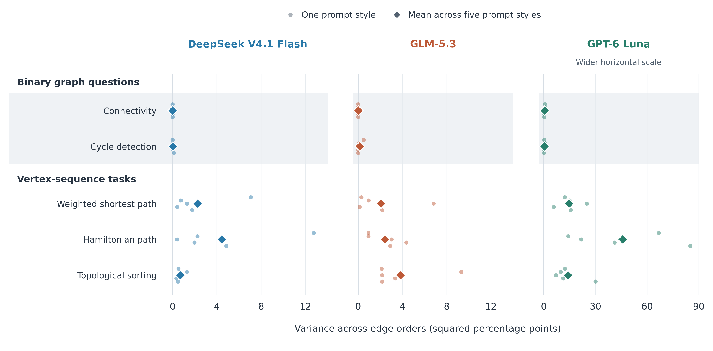

**Figure 6. Binary graph questions are less sensitive to edge order.** Dots show accuracy variance across five edge orders for each prompt style, and diamonds show mean variance across five prompt styles. Luna's panel uses a wider horizontal scale.

We hypothesize that the greater sensitivity of sequence tasks arises from having to maintain several graph constraints throughout an answer. A Hamiltonian path, for example, must follow graph edges and visit every vertex exactly once. Each choice of the next vertex must therefore leave a valid continuation through all remaining vertices. By comparison, a positive connectivity answer requires only that a path exists between the queried vertices, and that path need not visit every vertex.

**Table 8. Mean variance of accuracy across edge orders.** Each entry averages the population variances from the five prompt styles, in squared percentage points.

| Task | DeepSeek V4.1 Flash | GLM-5.3 | GPT-6 Luna |
| :--- | ---: | ---: | ---: |
| Connectivity | 0.00 | 0.02 | 0.52 |
| Cycle detection | 0.02 | 0.14 | 0.33 |
| Weighted shortest path | 2.25 | 2.07 | 14.69 |
| Hamiltonian path | 4.44 | 2.42 | 45.79 |
| Topological sorting | 0.69 | 3.82 | 14.11 |

> **Finding 6.** The most sensitive task depends on both the model and the prompt style.

Within the sequence tasks, the most sensitive task depended on both the model and the prompt style. The mean variances in Table 8 place Hamiltonian path first for DeepSeek and Luna and topological sorting first for GLM. None of these rankings reproduced GraphDO's result that shortest path was most sensitive. [GraphDO Figure 4](https://aclanthology.org/2025.acl-long.321.pdf#page=6) Prompting also changed the ranking for a fixed model and set of graphs. For Luna, Figure 7 identifies Hamiltonian path as the most sensitive task under zero-shot prompting and shortest path under zero-shot CoT. Across all models and prompt styles, shortest path led in only four of the 15 combinations.

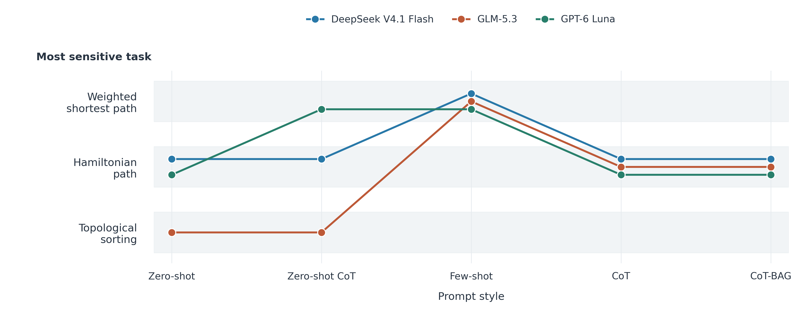

**Figure 7. The most sensitive task changes with the model and prompt style.** Points identify the task with the highest variance in each setting. Lines connect points for the same model, with small vertical offsets for visibility.

> **Finding 7.** Explicit reasoning does not consistently reduce sensitivity, and graph-construction instructions often increase it.

Explicit reasoning did not consistently reduce order sensitivity, despite the expectation that it might help models track graph constraints. In the left panel of Figure 8, adding a zero-shot CoT instruction produced as many increases as decreases in variance, with five of each across the 15 combinations of model and task. Worked CoT examples reduced variance in eight combinations relative to answer-only few-shot examples, but increased it in five. Additional reasoning guidance therefore did not reliably stabilize accuracy across orders. This resembles GraphDO's observation that CoT did not consistently remove order sensitivity. [GraphDO §4.2 Q2](https://aclanthology.org/2025.acl-long.321.pdf#page=6)

Adding graph-construction instructions more often increased order sensitivity than reduced it. In the CoT-to-CoT-BAG comparison in Figure 8, variance rose in nine of the 15 combinations of model and task and fell in only three. Luna's Hamiltonian results in the right panel illustrate the size of this increase, with variance more than doubling from 41.16 to 85.08 squared percentage points. Mean accuracy nevertheless remained almost unchanged, moving from 71.03% to 71.54%.

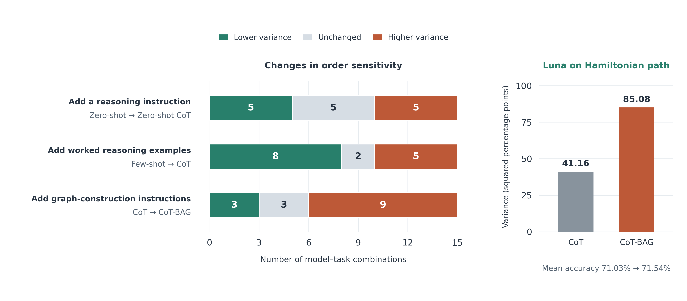

**Figure 8. Reasoning guidance does not reliably reduce order sensitivity.** The left panel counts variance changes across three models and five tasks. The right panel shows Luna's Hamiltonian example under CoT and CoT-BAG.

### 4.4 RQ3. Which orders work best for each task?

> **Finding 8.** A shared highest-scoring order can hide differences in its lead and consistency across prompt styles.

The same order can lead on average for different models without leading by the same margin or under the same prompt styles. On weighted shortest path, PPR had the highest mean accuracy for both Luna and DeepSeek in Table 9. For Luna, its lead over the next-best order, PR, was 4.71 percentage points. PPR also ranked first under four prompt styles and jointly first with PR under CoT, as Figure 9 shows. For DeepSeek, however, PPR led PR by only 0.57 points and ranked first only under few-shot and CoT-BAG prompting.

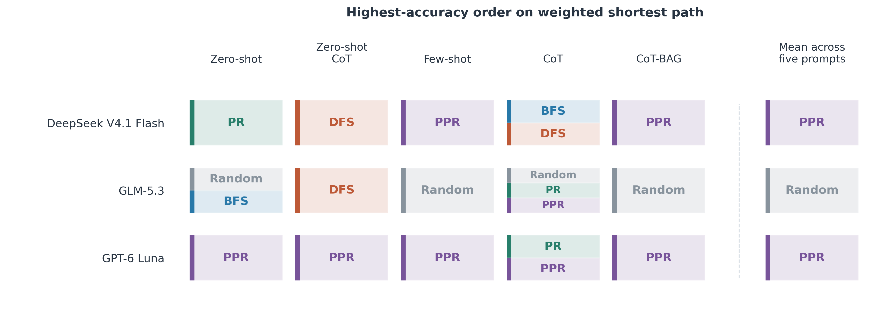

**Figure 9. Prompt-level winners on weighted shortest path.** Each cell names the highest-accuracy order, with split cells indicating ties. The final column identifies the order with the highest mean accuracy across the five prompt styles.

**Table 9. Traditional-task accuracy (%) averaged across five prompt styles.** Each entry summarizes 390 responses for Hamiltonian path and 700 for each other task. Bold marks the highest accuracy for a model and task, including ties.

| Task | Model | Random | BFS | DFS | PR | PPR |
| :--- | :--- | ---: | ---: | ---: | ---: | ---: |
| Connectivity | DeepSeek V4.1 Flash | **100.00** | **100.00** | **100.00** | **100.00** | **100.00** |
| Connectivity | GLM-5.3 | **100.00** | **100.00** | **100.00** | **100.00** | 99.86 |
| Connectivity | GPT-6 Luna | 99.14 | 99.57 | **99.86** | 99.71 | 98.29 |
| Cycle detection | DeepSeek V4.1 Flash | 99.86 | 99.86 | **100.00** | **100.00** | **100.00** |
| Cycle detection | GLM-5.3 | **99.86** | **99.86** | 99.57 | 99.71 | 99.71 |
| Cycle detection | GPT-6 Luna | 98.29 | **99.43** | 99.00 | 98.71 | 99.14 |
| Weighted shortest path | DeepSeek V4.1 Flash | 96.29 | 98.14 | 97.14 | 98.29 | **98.86** |
| Weighted shortest path | GLM-5.3 | **96.86** | 94.57 | 95.43 | 95.14 | 94.29 |
| Weighted shortest path | GPT-6 Luna | 79.57 | 80.71 | 79.43 | 83.43 | **88.14** |
| Hamiltonian path | DeepSeek V4.1 Flash | 89.74 | 90.00 | 88.46 | **90.51** | 88.21 |
| Hamiltonian path | GLM-5.3 | 97.18 | 98.21 | 97.18 | **98.97** | 97.44 |
| Hamiltonian path | GPT-6 Luna | 72.05 | 71.28 | **74.62** | 64.10 | 64.62 |
| Topological sorting | DeepSeek V4.1 Flash | 99.14 | 98.71 | 99.00 | **99.86** | 99.71 |
| Topological sorting | GLM-5.3 | 85.57 | 84.29 | **87.57** | 86.29 | 86.86 |
| Topological sorting | GPT-6 Luna | 83.71 | 82.14 | 85.43 | **90.00** | 88.71 |

> **Finding 9.** The preferred ordering family reverses between DeepSeek and Luna on node classification.

Node classification produced opposite ordering-family preferences for DeepSeek and Luna across all six combinations of dataset and sampling method. GraphDO reported that PR outperformed PPR and that probability-based orders generally outperformed traversal-based orders. [GraphDO §4.2 Q3](https://aclanthology.org/2025.acl-long.321.pdf#page=6) DeepSeek followed the same family-level pattern in Figure 10, where the better of PR and PPR outscored the better of BFS and DFS in every setting. Within the probability-based family, however, PR and PPR each led in three settings and both averaged 70.22% accuracy. For Luna, the better traversal-based order instead outperformed the better probability-based order in all six settings, by 2.67 to 17.33 percentage points. Random order nevertheless achieved the highest accuracy in three of Luna's settings, as Appendix B shows.

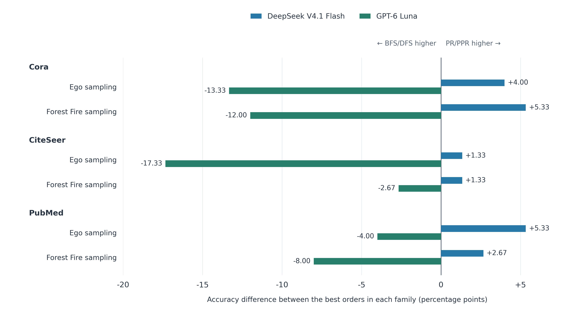

**Figure 10. Opposite ordering-family preferences on node classification.** Each bar shows the higher of the PR and PPR accuracies minus the higher of the BFS and DFS accuracies in the same setting. Each setting contains 25 questions evaluated three times.

> **Finding 10.** Small accuracy gaps can arise even when the compared orders produce identical prompts.

Accuracy rankings can reflect differences between separate model calls even when the graph description is unchanged. The archived Hamiltonian PR and PPR prompts were identical within each of the 390 retained combinations of graph and prompt style per model. Luna's mean accuracies differed by just 0.51 percentage points, but Figure 11 shows that 92 response pairs, or 23.6%, contained one correct and one incorrect answer. These disagreements almost balanced out between PR and PPR, leaving a small difference in mean accuracy. For DeepSeek, the disagreements were less balanced, producing a 2.31-point lead for PR. Because each pair used identical input, these ranking differences reflect response variation across calls.

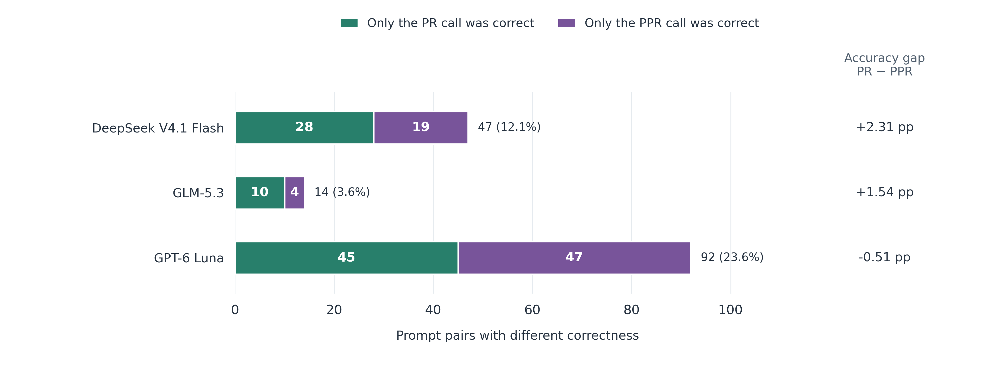

**Figure 11. Correctness variation under identical Hamiltonian prompts.** Within each of the 390 PR/PPR pairs per model, the two prompts were identical. Bars count pairs in which only one response was correct. The right column shows the net accuracy difference.

## 5. Discussion

### 5.1 Transferability of ordering benefits

Structured edge ordering needs to be validated for the model, task, and prompt style in which it will be used. Our replication recovers GraphDO's broad contrast between less sensitive binary questions and more sensitive sequence tasks, but does not reproduce its consistent accuracy gains over random order. For Luna, all four structured orders improved mean accuracy on traditional tasks while reducing it on node classification. An order's success in one task family therefore provides insufficient evidence for adopting it in another. A practical evaluation should include random order and validate the chosen strategy on held-out graphs.

### 5.2 Why different models may favor different orders

An order may help when the relationships it emphasizes match both the task and the way a model uses the input sequence. In node classification, the comparison of each family's best order favored probability-based ordering for DeepSeek and traversal-based ordering for Luna in all six settings. This contrast motivates testing whether the same sequence cues provide useful guidance to different models. GraphDO's deeper exploration examines such guidance on the shortest-path task, using shortest-path and longest-path edge orders to vary alignment with the answer. [GraphDO §5](https://aclanthology.org/2025.acl-long.321.pdf#page=7) Repeating that comparison across our models would test whether the benefit of answer alignment itself changes with the model.

### 5.3 Separating ordering effects from response variation

Repeated responses are needed to determine whether an observed ordering advantage is reproducible. The Hamiltonian PR and PPR comparison in §4.4 provides a useful control, because the prompts were identical within each pair but the responses still differed in correctness. These accuracy gaps cannot be attributed to edge reordering. With one response per traditional-task prompt, gaps between genuinely different orders can likewise contain both ordering effects and response variation. A follow-up evaluation should repeat each fixed prompt under every order and estimate uncertainty in the paired accuracy differences. Order selection could then consider both the estimated gain and its consistency across calls.

## 6. Limitations

Our replication uses different hosted models and smaller, newly sampled datasets, which limits direct comparison with GraphDO. Some released prompts differ from the published examples, and the original responses are unavailable for rescoring under a common procedure. [GraphDO Table 4](https://aclanthology.org/2025.acl-long.321.pdf#page=16) · [Public implementation](https://github.com/YuyaoGe/GraphDO/tree/4ba8f925c76574e2fca8d4f32f753b57a341b44f) The small graphs and imbalanced task labels also limit generalization, while excluding 62 underspecified Hamiltonian graphs changes that task's sample distribution. For node classification, overlapping subgraphs and repeated prompts limit the independence of observations, and GLM is excluded because of frequent blank responses. For the retained models, abstentions and tool calls without predictions count as incorrect, so accuracy also reflects whether an answer is supplied. Seven traditional-task responses remain ambiguous, but all possible score assignments preserve the direction of mean ordering effects and leave every Holm-corrected comparison nonsignificant.

## 7. Conclusion

We revisited GraphDO's three research questions across five edge orders, six graph tasks, and three hosted models. The replication recovers the broad distinction between less sensitive binary questions and more sensitive sequence tasks, but finds much smaller and less consistent accuracy gains from structured ordering. None of the 300 traditional-task comparisons with random order reached statistical significance after Holm correction. The preferred order varied with the task, model, and prompt style, and an order that helped one task family could reduce accuracy in another. These observed preferences also need to be distinguished from response variation, as identical prompts sometimes produced different correctness outcomes. Our findings therefore support validating ordering strategies for the intended model, task, and prompt style, with repeated responses to assess the reproducibility of any observed advantage.

## References

Fagerland, M. W., Lydersen, S., & Laake, P. (2013). The McNemar test for binary matched-pairs data: mid-p and asymptotic are better than exact conditional. *BMC Medical Research Methodology, 13*, 91. [DOI](https://doi.org/10.1186/1471-2288-13-91)

Ge, Y., Liu, S., Bi, B., Wang, Y., Mei, L., Feng, W., Chen, L., & Cheng, X. (2025). *Can Graph Descriptive Order Affect Solving Graph Problems with LLMs?* Proceedings of the 63rd Annual Meeting of the Association for Computational Linguistics, pp. 6404–6420. [ACL Anthology](https://aclanthology.org/2025.acl-long.321/)

Holm, S. (1979). A simple sequentially rejective multiple test procedure. *Scandinavian Journal of Statistics, 6*(2), 65–70. [DOI](https://doi.org/10.2307/4615733)

## Appendix A. Reproducibility

The experiment is stored at `/mnt/new_ssd_3/taojie/comp5222-graphdo/half-scale` on the course project server. `experiment.json` records the design. The provenance files under `benchmark/traditional/` and `benchmark/node/` record the public commit, seed, package versions, and manifest hashes. Responses are keyed by case ID and model in the SQLite files under `runs/traditional/` and `runs/node/`. The 5,991 recovered GLM answers are stored under `repair-glm-4096/runs/traditional/`. The Forest Fire sampling compatibility fix is documented in `logs/node-sampler-compatibility.json`.

The report uses the case-level `scores` field in `analysis/audited_final_scores.json`, which contains the retained traditional-task responses. Its `archived_scores` field preserves all generated cases. The 62 excluded Hamiltonian graph IDs are recorded explicitly and applied to every model, order, and prompt style. Node-classification scores are in `analysis/node_score_audit.json`. Both supersede the earlier server scores. From the local project directory, run `python3 analysis/audit_node_scores.py`, `python3 analysis/review_scores.py`, `python3 analysis/analyze_rq1.py`, and `python3 analysis/analyze_rq2.py`. The audit uses frozen responses and graph metadata without additional model calls. `analysis/manual_answer_review.json` records exceptional answer decisions with source-text hashes, and `analysis/false_negative_review.json` records score changes. `analysis/SCORING_AUDIT.md` documents validation, ambiguous responses, and the sensitivity check. Figure generators in `figures/plot_*.py` read the current score and analysis files.

## Appendix B. Node-Classification Accuracy by Dataset and Sampler

**Table B1. Node-classification accuracy (%).** Each cell contains 75 responses (25 sampled questions × three repeats). Bold marks each row's highest accuracy, including ties.

| Dataset | Sampler | Model | Random | BFS | DFS | PR | PPR |
| --- | --- | --- | ---: | ---: | ---: | ---: | ---: |
| Cora | Ego | DeepSeek V4.1 Flash | 62.67 | 60.00 | 57.33 | 60.00 | **64.00** |
| Cora | Ego | GPT-6 Luna | 52.00 | 46.67 | **57.33** | 44.00 | 41.33 |
| Cora | Forest Fire | DeepSeek V4.1 Flash | 76.00 | 76.00 | 76.00 | 80.00 | **81.33** |
| Cora | Forest Fire | GPT-6 Luna | **72.00** | 62.67 | 64.00 | 52.00 | 49.33 |
| CiteSeer | Ego | DeepSeek V4.1 Flash | 62.67 | 61.33 | 62.67 | **64.00** | 58.67 |
| CiteSeer | Ego | GPT-6 Luna | 40.00 | 45.33 | **53.33** | 33.33 | 36.00 |
| CiteSeer | Forest Fire | DeepSeek V4.1 Flash | 60.00 | 60.00 | 62.67 | **64.00** | 61.33 |
| CiteSeer | Forest Fire | GPT-6 Luna | 48.00 | **60.00** | 56.00 | 48.00 | 57.33 |
| PubMed | Ego | DeepSeek V4.1 Flash | 64.00 | 61.33 | 68.00 | 66.67 | **73.33** |
| PubMed | Ego | GPT-6 Luna | **54.67** | 46.67 | 37.33 | 42.67 | 38.67 |
| PubMed | Forest Fire | DeepSeek V4.1 Flash | 81.33 | 84.00 | 84.00 | **86.67** | 82.67 |
| PubMed | Forest Fire | GPT-6 Luna | **74.67** | 62.67 | 54.67 | 54.67 | 49.33 |
