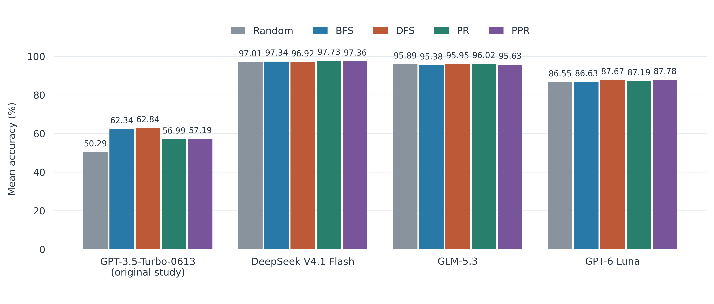

# Revisiting Graph Reasoning in Modern Large Language Models

HKUST COMP5222 course project reproducing the graph-description ordering study of Ge et al. (2025) with DeepSeek V4.1 Flash, GLM-5.3, and GPT-6 Luna.

**[Read the report](COMP5222_GraphDO_Report.md)** · **[Reproduce the analysis](REPRODUCTION.md)** · **[Scoring acceptance record](analysis/SCORING_RELEASE.md)**

We compare random edge order with BFS, DFS, PageRank, and Personalized PageRank across five traditional graph tasks and node classification. The traditional tasks use five prompt styles. Node classification uses zero-shot prompts on Cora, CiteSeer, and PubMed with two sampling methods.

The report uses the accepted scoring release **`scoring-v1-20261122`**. It contains 47,850 retained traditional-task responses and 4,500 node-classification responses. The full traditional archive also preserves 4,650 responses excluded because 62 Hamiltonian graphs had underspecified prompts. GLM's node-classification run is excluded because of frequent blank responses.

## Main findings

Structured orders produce smaller and less consistent benefits than in the original study. Accuracy increases in 122 of 300 comparisons with random order, stays unchanged in 107, and decreases in 71. None of the paired comparisons is significant after Holm correction.

| Model | Traditional-task macro accuracy |
| --- | ---: |
| DeepSeek V4.1 Flash | 97.27% |
| GLM-5.3 | 95.78% |
| GPT-6 Luna | 87.16% |

These means weight the 25 task and prompt-style combinations equally. Binary graph questions are generally less sensitive to order than tasks requiring vertex sequences. The preferred order depends on the model, task, and prompt style, and an advantage in one task family can reverse in another.



## Repository contents

| Path | Contents |
| --- | --- |
| `COMP5222_GraphDO_Report.md` | Current report with GitHub-compatible figure links |
| `experiments/half-scale/` | Main experiment configuration, runner, benchmark manifests, and GLM recovery scripts |
| `experiments/GraphDO/` | Upstream submodule pinned to `4ba8f925c76574e2fca8d4f32f753b57a341b44f` |
| `experiments/model_adapters.py` | Original model invocation adapters |
| `experiments/benchmark/subset/` | Earlier two-task pilot benchmark |
| `analysis/` | Saved responses, reviewed scores, analysis scripts, and audit evidence |
| `analysis/releases/scoring-v1-20261122/` | Accepted files and original hash manifest, with one sensitive input omitted as documented below |
| `figures/` | Report figures in PNG/SVG and their Python generators |
| `tools/verify_artifacts.py` | Offline integrity and report-image checks, without rescoring |

## Quick start

Use Python 3.12 or later. Clone with submodules to include the original GraphDO implementation.

```sh
git clone --recurse-submodules git@github.com:dequeueing/ml_graph_project.git
cd ml_graph_project
python3 tools/verify_artifacts.py
```

The integrity check uses only Python's standard library and makes no model requests. The saved analysis inputs contain responses and graph metadata. One credential-like string in a saved model answer was redacted for this GitHub export. The corresponding original frozen input is omitted, and all accepted scores remain unchanged. [Publication details](analysis/PUBLICATION.md) record the scope and hashes. Exact replay of the original acceptance requires the unredacted input retained locally.

The original SQLite run databases, downloaded citation-network caches, Python environments, and host credentials remain on the experiment server.

The original server experiment code is under `experiments/`. Its provisional evaluator outputs are historical and are superseded by the reviewed scores in `analysis/`. The current report and additional figures have evolved since acceptance. The complete, unmodified accepted snapshot remains in the local source project.

## Reference

Ge et al. (2025). *Can Graph Descriptive Order Affect Solving Graph Problems with LLMs?* Proceedings of ACL 2025. [Paper](https://aclanthology.org/2025.acl-long.321/) · [Original implementation](https://github.com/YuyaoGe/GraphDO)

The upstream implementation is included as a pinned submodule. This course project does not change its ownership or licensing terms.
